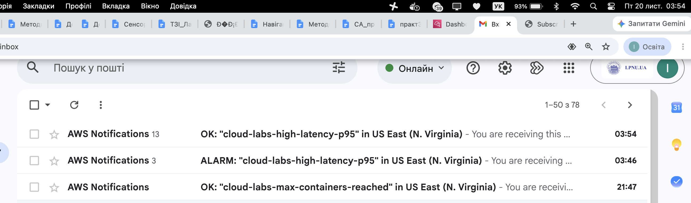

# Налаштування сповіщень (CloudWatch Alarm + AWS SNS)

## Конфігурація правила тривоги
Для автоматичного оповіщення про деградацію швидкодії сервісу створено SNS-топік `cloud-labs-alerts-topic` із email-підпискою (`iryna.lutsan.ir.2024@lpnu.ua`) та правило **CloudWatch Metric Alarm** (`cloud-labs-high-latency-p95`):

- **Метрика:** `AWS/ApplicationELB` → `TargetResponseTime` (для балансувальника `cloud-labs-alb`)
- **Статистика:** `p95` (95-й перцентиль часу відповіді)
- **Умова спрацювання (`ALARM`):** `TargetResponseTime (p95) > 0.5` секунди (500 мс) протягом **2 послідовних періодів по 60 секунд** (`evaluation_periods = 2`, `period = 60`)
- **Дії при тривозі (`alarm_actions`):** відправка сповіщення в SNS
- **Дії при відновленні (`ok_actions`):** відправка сповіщення в SNS після повернення показника в норму

## Підтвердження отримання листів

## Оцінка часу реакції системи

| Подія | Час (EET) | Опис стану |
| :--- | :--- | :--- |
| **Перехід у стан `ALARM`** | `03:46` | Під час наростання навантаження на старті тесту (початок о `03:40` EET / `01:40` UTC) затримка `p95` перевищила поріг `0.5 s` протягом двох 1-хвилинних інтервалів підряд, після чого на пошту надійшов лист `ALARM: "cloud-labs-high-latency-p95"` |
| **Повернення у стан `OK`** | `03:54` | Після завершення тесту (`03:52` EET / `01:52` UTC) та отримання двох 1-хвилинних вимірів із латентністю нижче `0.5 s` тривога автоматично перейшла в стан `OK` і надіслала лист про стабілізацію. |

- **Час виявлення інциденту (MTTD):** **~2–3 хвилини** від перетину порогу латентності (2 періоди оцінки по 60 с + ~30–60 с на агрегацію метрик ALB у CloudWatch та доставку листа через AWS SNS).
- **Час фіксації відновлення:** **~2 хвилини** після завершення навантаження (`03:52` → `03:54` EET)