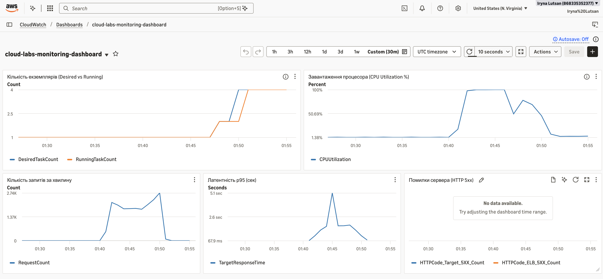

# Налаштування та робота горизонтального автомасштабування

## Параметри політики масштабування (Terraform)
Автомасштабування сервісу `cloud-labs-service` у кластері `cloud-labs-cluster` (AWS ECS Fargate) реалізовано за допомогою **Target Tracking Scaling Policy**:

- **Мінімальна кількість екземплярів (`min_capacity`):** `1` задача
- **Максимальна кількість екземплярів (`max_capacity`):** `4` задачі
- **Цільова метрика:** `ECSServiceAverageCPUUtilization`
- **Цільове значення (`target_value`):** `60%` середнього завантаження CPU
- **Час стабілізації при розширенні (`scale_out_cooldown`):** `60` секунд
- **Час стабілізації при звуженні (`scale_in_cooldown`):** `180` секунд
- **Ресурси однієї задачі:** `0.25 vCPU` (`256` CPU units), `512 MB` RAM

## Хронологія подій під час тестування (CloudWatch Dashboard)

1. **Початок навантаження (`01:40` UTC):** після старту сценарію `k6` кількість запитів на балансувальник різко зросла, досягнувши піку `2 740` запитів/хв[cite: 11].
2. **Перетин порогу CPU (`01:42` UTC):** завантаження процесора перевищило цільовий показник `60%` і вийшло на пік **`100%`**[cite: 11].
3. **Поява нових екземплярів (`01:47–01:50` UTC):** спрацювала політика масштабування — кількість контейнерів спершу зросла з **`1` до `2`** (`01:47` UTC), а о `01:50` UTC досягла встановленого максимуму — **`4` екземпляри**, що дозволило знизити середнє завантаження CPU до ~`50%`[cite: 11].
4. **Вилучення екземплярів (після завершення тесту):** після спаду навантаження та спливу періоду охолодження (`scale_in_cooldown = 180s`) надлишкові контейнери були автоматично зупинені, і сервіс повернувся до базового стану (`1` екземпляр).