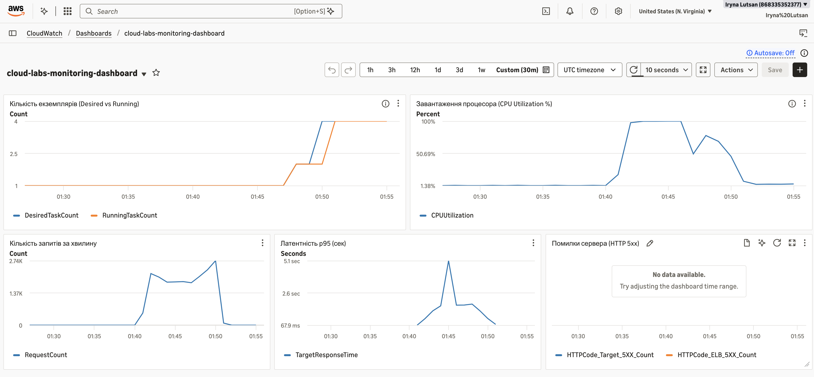

# Реалізація та ефективність кешування (Завдання 5)

## Архітектура кешування
Для оптимізації читань у сервісному шарі (`app/app/my_project/service/services.py`) реалізовано **In-Memory кеш за патерном Cache-Aside** із часом життя записів **TTL = 45 секунд**:

- **`GET /users` (`get_all_users`):** повний серіалізований список користувачів зберігається в оперативній пам'яті процесу (`_users_list_cache`). При повторних запитах протягом 45 секунд дані повертаються напряму з пам'яті без виконання SQL-запиту `SELECT * FROM users` до Amazon RDS.
- **`GET /users/:id` (`get_user_by_id`):** окремі об'єкти користувачів кешуються у словнику `_user_by_id_cache` за ключем `user_id` на 45 секунд.
- **Інвалідація:** при оновленні (`update_user`) або видаленні (`delete_user`) запису кеш очищається примусово.

## Порівняльна таблиця результатів («Без кешу» vs «З кешем»)

Обидва тестування проводилися за ідентичним сценарієм `k6` (до 50 VU, 9 хв 30 с, співвідношення 1 запис : 9 читань) із 100% успішних запитів:

| Показник | Без кешу (Базовий тест) | З кешем (In-Memory, TTL 45 с) | Зміна / Ефект |
| :--- | :--- | :--- | :--- |
| **Оброблено запитів (`http_reqs`)** | `5 300` | `19 300` | **×3.64 більше** |
| **Пропускна здатність (`req/s`)** | `9.30 req/s` | `33.83 req/s` | **+264% (×3.64)** |
| **Пік запитів за хвилину (ALB)** | `978 req/min` | `2 740 req/min` | **×2.80 більше** |
| **Середня затримка (`avg`)** | `4.24 s` | `1.12 s` | **-73.6% (×3.79 швидше)** |
| **Медіанна затримка (`p50`)** | `4.69 s` | `1.02 s` | **-78.3% (×4.60 швидше)** |
| **Латентність `p95`** | `7.62 s` | `1.78 s` | **-76.6% (×4.28 швидше)** |
| **Переданий трафік (`data_received`)** | `783 MB` (`1.4 MB/s`) | `8.6 GB` (`15 MB/s`) | **×11 більше даних** |
| **Частка помилок (`http_req_failed`)** | `0.00%` | `0.00%` | **Стабільна робота** |

## Розрахункова частка влучань у кеш (Cache Hit Ratio)
У кожній ітерації виконується **5 запитів** до списку `GET /users` та **4 запити** `GET /users/:id` (разом 9 читань).
- Для ендпоінту `GET /users` протягом 45 секунд на кожному контейнері виконується рівно **1 промах (`Cache MISS`)** для завантаження даних із RDS. При середній інтенсивності ~`16.9 req/s` на цей маршрут за 45 секунд надходить ~`760` запитів, з яких ~`756–759` обслуговуються з пам'яті — тобто **Cache Hit Ratio для `GET /users` становить >99%**.
- Загальний **Cache Hit Ratio по всіх операціях читання** (з урахуванням перших звернень до нових `GET /users/:id` після їхнього створення) становить **~88–90%**.

## Аналіз компромісів та актуальності даних (Stale Data)
1. **Затримка оновлення даних (Eventual Consistency):** оскільки при створенні нового користувача (`POST /users`) загальний список `_users_list_cache` не скидається миттєво, а оновлюється за таймером **TTL = 45 с**, клієнти можуть бачити стан списку користувачів із затримкою до 45 секунд. Для довідкових списків це прийнятний компроміс, що розвантажує базу даних RDS.
2. **Розсинхронізація при горизонтальному масштабуванні:** під час тесту сервіс розширився до `4` контейнерів. Оскільки кеш зберігається локально в оперативній пам'яті кожного Python-процесу, кожна репліка має власну копію кешу з власним часом оновлення. Через це різні контейнери можуть тимчасово віддавати дещо відмінні версії списку (поки не спливе їхній локальний TTL). Для повної консистентності між репліками в production-системах використовують спільний зовнішній кеш (наприклад, **Amazon ElastiCache for Redis**).